<div align="center">
  
</div>

<div align="center">
  
  
  
  <a href="https://codeforces.com/profile/Madmins07"></a>
</div>

## about

Every accepted submission from the contest grind, kept as plain source files. Codeforces handle
[**Madmins07**](https://codeforces.com/profile/Madmins07), peak rating 1541 (Specialist).

| platform | solved | folder |
|:--|--:|:--|
| Codeforces | 205 | [`codeforces/`](codeforces) |
| LeetCode | 102 | [`Leetcode/`](Leetcode) |

The full problem-by-problem list, with links to each problem page, lives in [**INDEX.md**](INDEX.md).

## conventions

- Codeforces files are named by problem id, so `1549A.cpp` is problem A of contest 1549.
- LeetCode files are named by problem slug, so `two-sum.cpp` is *Two Sum*.
- Everything is C++17 unless the extension says otherwise.

## run one

```bash
g++ -std=c++17 -O2 -o sol codeforces/1549A.cpp && ./sol < input.txt
```

---

<div align="center">
  <sub>Part of <a href="https://github.com/Madmins07">Madmins07</a> · Madhav Agarwal · IIT Kharagpur</sub>
</div>
